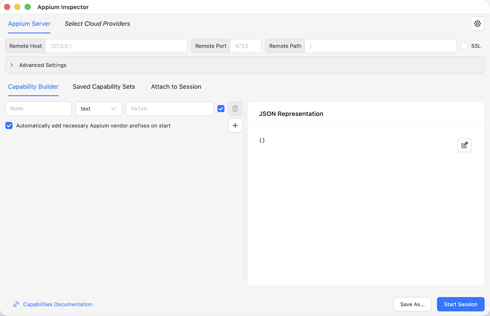
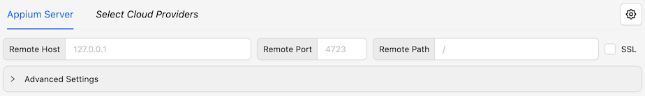
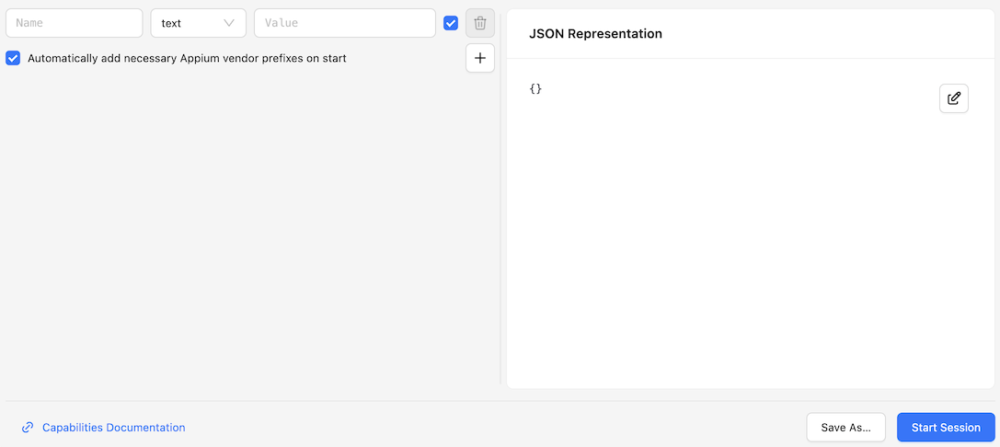
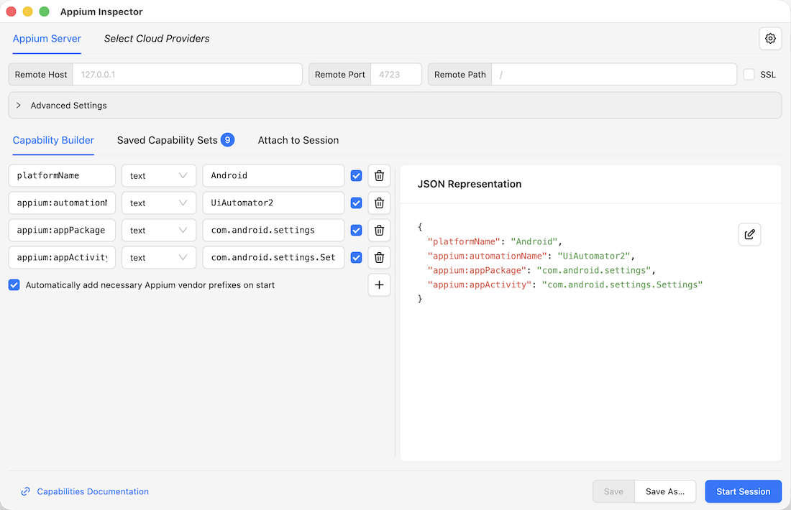
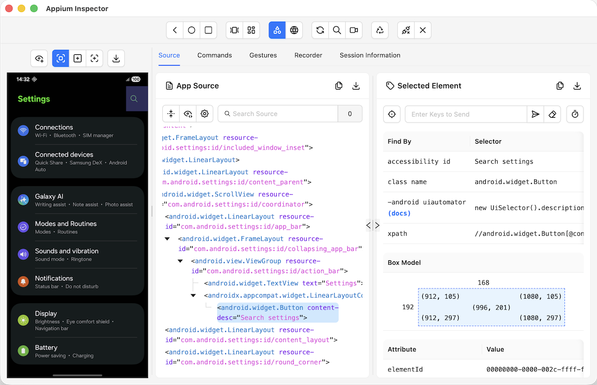

---
hide:
    - navigation

title: Getting Started
---

## System Requirements

Installation requirements depend on [the selected distribution format](./overview.md#formats):
standalone desktop app, or Appium server plugin.

=== "Standalone Desktop Application"

    - Windows 10+, macOS 13+, Ubuntu 18.04+, Debian 10+, openSUSE 15.5+, or Fedora Linux 39+
        - [These requirements are taken from Chrome](https://support.google.com/chrome/a/answer/7100626),
          as the Inspector is built using Electron (which uses Chromium)
    - Around 500MB of free space

=== "Appium Server Plugin"

    - Appium
    - Node.js `^20.19.0 || ^22.12.0 || >=24.0.0`
    - Chrome/Edge/Firefox/Safari, released in 2022 or later
    - Around 9MB of free space

    Make sure to use a plugin version that is compatible with your Appium server version. This only
    refers to the Appium versions under which the plugin _can be installed_, _not_ the Appium
    versions on servers that the Inspector _can connect to_ - [see below](#appium-server-requirements)
    for the latter.

    | Appium server version | Compatible Inspector plugin versions |
    | --- | --- |
    | Appium 4 | >= 2026.11.6 |
    | Appium 3 | >= 2025.3.1 |
    | Appium 2 | 2025.3.1 - 2025.7.3 |

## Appium Server Requirements

The Inspector cannot do much without an **Appium server** to connect to. Unless you only want to
connect to existing Appium servers, you will need to install and set up a server of your own,
which can be hosted either locally or remotely. For instructions on how to do this, please refer
to the [Appium documentation](https://appium.io/docs/en/latest/quickstart/install/).

Not all major Appium versions are equally supported by all Inspector versions. While it is likely
that the Inspector still supports basic creation of Appium 1 sessions, many application features do
not work in such sessions. The following table lists the generally recommended Inspector app
versions depending on your target Appium server version:

| Target Appium server version | Inspector versions with general support |
| --- | --- |
| Appium 4 | >= 2026.11.5 |
| Appium 3 | >= 2025.3.1 |
| Appium 2 | >= 2021.8.5 |
| Appium 1 | <= 2024.12.1 |

If setting up your own server, make sure to also install the **Appium driver(s)** for your target
platform(s). You can find links to all known drivers in the [Appium documentation's Ecosystem page](https://appium.io/docs/en/latest/ecosystem/drivers/).
Refer to each driver's documentation for its specific requirements and setup instructions.

Certain Inspector features may not work for older versions of certain drivers, so the following
driver versions are recommended for best compatibility with the latest Inspector version:

- [Espresso](https://appium.github.io/appium-espresso-driver): `4.0.0` or later
- [Mac2](https://appium.github.io/appium-mac2-driver): `2.0.0` or later
- [UiAutomator2](https://appium.github.io/appium-uiautomator2-driver/): `6.6.0` or later
- [WinCore](https://appium.github.io/appium-wincore-driver/): `3.0.0` or later
- [Windows](https://github.com/appium/appium-windows-driver/): `4.0.0` or later
- [XCUITest](https://appium.github.io/appium-xcuitest-driver/): `12.20.0` or later

## Installation

Like with system requirements, the installation steps also differ depending on the selected
distribution format.

### Desktop App

The standalone Appium Inspector desktop application is published for Windows, macOS and Linux.

=== ":material-microsoft-windows: Windows"

    The app can either be downloaded manually, or installed through WinGet.

    === "Manual Download"

        The app can be downloaded from the Inspector's GitHub repository: <https://github.com/appium/appium-inspector/releases>

        Releases are published for `x64` and `arm64` platforms, in `.exe` and `.zip` formats. It is
        recommended to use the `.exe` installer file, as it supports [checking for updates](./menu-bar.md#update-checker).

    === "WinGet"

        WinGet distribution is entirely community-supported, and is not maintained by the Appium team.

        ```sh
        winget install AppiumDevelopers.AppiumInspector
        ```

=== ":material-apple-finder: macOS"

    The app can be downloaded from the Inspector's GitHub repository: <https://github.com/appium/appium-inspector/releases>

    Releases are published for `x64` and `arm64` platforms, in `.dmg` and `.zip` formats. It is
    recommended to use the `.dmg` installer, as it supports [checking for updates](./menu-bar.md#update-checker).

=== ":simple-linux: Linux"

    The app can be downloaded from the Inspector's GitHub repository: <https://github.com/appium/appium-inspector/releases>

    Releases are published for `x64` and `arm64` platforms, in `.AppImage` files and `.tar.gz` formats.
    It is recommended to use the `.AppImage` file, as it supports [checking for updates](./menu-bar.md#update-checker).

    In order to open the `.AppImage` file, its executable flag needs to be set first:

    ```sh
    chmod a+x Appium-Inspector-<version>-linux-<arch>.AppImage
    ```

    Afterwards, the app can be opened through the command line:

    ```sh
    ./Appium-Inspector-<version>-linux-<arch>.AppImage
    ```

### Appium Plugin

Like all Appium plugins, the Inspector plugin can be installed and activated using
[the Appium command line](https://appium.io/docs/en/latest/cli/).

1.  Install the plugin:

    === "Appium 3+"

        ```bash
        appium plugin install inspector
        ```

    === "Appium 2"

        ```bash
        # Appium 2 does not support the 'inspector' shortcut, and 2025.7.3 is its last compatible version
        appium plugin install --source=npm appium-inspector-plugin@2025.7.3
        ```

2.  Launch the Appium server with the plugin activated:

    === "Appium 4"

        ```bash
        appium --use-plugins=inspector --allow-insecure='*:cors'
        ```

        Appium 4 rejects state-changing requests sent from web pages unless CORS is enabled,
        which includes the Inspector page served by the plugin itself. See
        [Troubleshooting](./troubleshooting.md#cannot-start-a-session-using-plugin-version).

    === "Appium 2-3"

        ```bash
        appium --use-plugins=inspector
        ```

3.  Open the Inspector URL in your web browser:
    ```
    http://127.0.0.1:4723/inspector
    ```

    !!! info

        Make sure the above **host URL** and **port** match those of the Appium server. The server's
        **base path** value is irrelevant, as the plugin always uses the `/inspector` path.

        Check [the Troubleshooting guide](./troubleshooting.md#cannot-start-a-session-using-plugin-version)
        if you are unable to create a session.

## Creating a Session

Once the Inspector is installed and opened, the following screen should be shown:

{ width="400" }

This is the [**Session Builder**](./session-builder/index.md) screen, where the server
and session details must be specified.

### Adding Server Details

{ width="700" }

The [server details section](./session-builder/server-details.md) at the top of the window contains
information about the Appium server, so that the Inspector knows how to connect to it:

- If you wish to connect to a cloud provider service, select your vendor using the _Select Cloud
  Providers_ button, switch to its tab, and fill in its required details.
- If you wish to connect to a standalone local or remote Appium server, first make sure the server
  is launched and running. The start of the server log will have a list of IP addresses and ports
  that can be used to connect to the server.
    - For a local Appium server running on its default port, **all server details fields can be left
      unchanged**. By default, the Inspector will attempt to connect to `http://127.0.0.1:4723`,
      which matches the default values of the Appium server.
    - For a local or remote Appium server with non-default properties, please change the field
      values accordingly.

### Adding Session Details

{ width="500" }

The [Capability Builder](./session-builder/capability-builder.md) take up the majority of the
Session Builder screen, and contains information about the [session capabilities](https://appium.io/docs/en/latest/guides/caps/).

!!! warning

    Appium has several mandatory capabilities (see above link). Attempting to start a new session
    without any capabilities will not work.

There are multiple ways to specify the session capabilities:

* Enter them [one by one on the left side](./session-builder/capability-builder.md#capability-fields)
* [Edit the whole capability set in JSON format on the right](./session-builder/capability-builder.md#capability-json-structure)
* [Import capabilities from an `.appiumsession` file](./session-builder/saved-capability-sets.md#import-from-file)
  in the Saved Capability Sets tab
* [Apply one of the built-in capability templates](./session-builder/saved-capability-sets.md#use-template)
  in the Saved Capability Sets tab

You may also want to consult the documentation of your target driver, which should provide a list
of all its supported capabilities, as well as some basic examples. 

### Launching the Session

Here is an example image of a Session Builder with fully configured server and session information:

{ width="600" }

You can see the following details:

- The server details are unchanged: the Inspector will try to connect to a local Appium server on
  its default port
- The session capabilities specify the UiAutomator2 driver, with additional capabilities for the
  Android system settings app

Of course, your own server and session details will likely vary.

Clicking the _Start Session_ button will send a new session request to the Appium server, and if
successful, the **[Session Inspector](./session-inspector/index.md)** screen should open:

{ width="400" }

If this works, great! You can now start exploring your app using the various features described in
the Session Inspector page.

If something went wrong, please check the [Troubleshooting](./troubleshooting.md) page for
potential issues.
