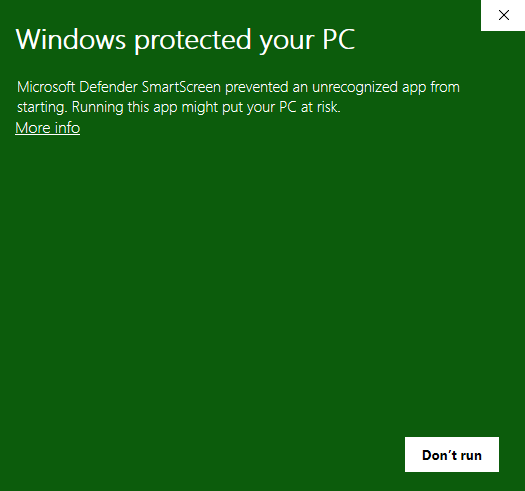

Installation steps differ depending on the selected distribution format.

## Appium Plugin

Like all Appium plugins, the Inspector plugin can be installed and activated using
[the Appium command line](https://appium.io/docs/en/latest/cli/).

1.  Install the plugin:

    === "Appium 3+"

        ```bash
        appium plugin install inspector
        ```

    === "Appium 2"

        ```bash
        # 2025.7.3 is the last version compatible with Appium 2 installs
        appium plugin install --source=npm appium-inspector-plugin@2025.7.3
        ```

2.  Launch the Appium server with the plugin activated:

    === "Appium 4"

        ```bash
        appium --use-plugins=inspector --allow-insecure='*:cors'
        ```

        Appium 4 rejects state-changing requests sent from web pages unless CORS is enabled,
        which includes the Inspector page served by the plugin itself. See
        [Troubleshooting](../troubleshooting.md#cannot-start-a-session-using-plugin-version).

    === "Appium 2-3"

        ```bash
        appium --use-plugins=inspector
        ```

3.  Open the Inspector URL in your web browser:
    ```
    http://127.0.0.1:4723/inspector
    ```

!!! info

    Make sure the above **host URL** and **port** match those of the Appium server. The server's
    **base path** value is irrelevant, as the plugin always uses the `/inspector` path.

    Check [the Troubleshooting guide](../troubleshooting.md#cannot-start-a-session-using-plugin-version)
    if you are unable to create a session.

## Desktop App

The app can be downloaded from [the Inspector's GitHub repository](https://github.com/appium/appium-inspector/releases).
Different file formats are provided for each supported platform. In addition to manual downloads,
there are also unofficial ways to install the app using the command line.

### Windows

#### Manual Download

It is recommended to download the `.exe` installer file, as it supports [checking for updates](../menu-bar.md#update-checker).

Since the app is currently not signed, Windows will show a security warning to prevent you from
opening the installer file. This can be bypassed with sufficient user permissions:

??? info "Handling installation warnings on Windows"

    1. Right-click on the installer file and click _Properties_ - a new window should open.
    2. Near the bottom of the window, there will be an _Unblock_ checkbox - check it.
    3. Click _OK_.
    4. You should now be able to open the installer without issues.

    Alternatively, you can also bypass this after having opened the installer:

    1. Upon opening the installer, the following warning will likely be shown.
       
    2. Click _More info_ - a new button _Run anyway_ should appear at the bottom.
    3. Click _Run anyway_ - the installer window should open.

    After following the installer steps, the Inspector app should be installed, and you should be able
    to open it without any warnings.

#### WinGet

It is possible to install the Inspector through WinGet. Please note that this method is only
community-supported, and is not maintained by the Appium team.

```sh
winget install AppiumDevelopers.AppiumInspector
```

### macOS

It is recommended to download the `.dmg` installer file, as it supports [checking for updates](../menu-bar.md#update-checker).

Opening the file will open a simple window, showing icons for the Inspector and the _Applications_
folder. Drag-and-drop the Inspector icon over the _Applications_ icon to extract the app, and
afterwards open it from that folder.

### Linux

It is recommended to download the `.AppImage` file, as it supports [checking for updates](../menu-bar.md#update-checker).

In order to open the file, its executable flag needs to be set first:

```
chmod a+x Appium-Inspector-<version>-linux-<arch>.AppImage
```

Afterwards, the app can be opened through the command line:

```
./Appium-Inspector-<version>-linux-<arch>.AppImage
```
