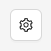

---
hide:
    - toc

title: Application Settings
---

The application settings can be accessed using the button in the top-right of the Session Builder screen.

## Refresh order

By default, the Inspector requests the screenshot first when refreshing a session. Enable
**Request page source before screenshot** to request the page source first. This can help reduce
mismatches between the page source and screenshot when the app changes screens during refresh.
The setting applies the next time you start or attach to a session in the Inspector.

## Theme

By default, the Inspector follows the system theme, but it is possible to explicitly switch to
a light or dark theme.

## Language

The language dropdown allows you to change the entire application language. Currently there are over 20
available languages with community-provided translations!

!!! note

    Most languages only include partial translations. You can help by providing your translations on
    [Crowdin](https://crowdin.com/project/appium-desktop)!
